

  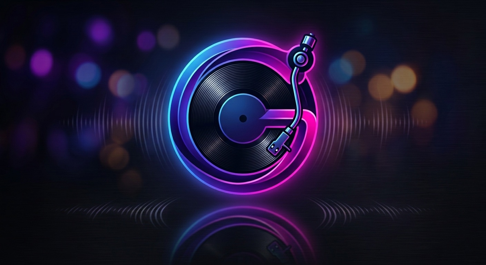

<h1 align="center">GlideMix</h1>

  <b>Build DJ mixes on a timeline. Every transition perfect, every beat in place.</b> 
  For DJs who prepare mixtapes, radio shows and sets, on macOS and Windows.

  <a href="https://glidemix.com"><b>🌐 glidemix.com</b></a>
  &nbsp;·&nbsp; <a href="../../releases/latest"><b>⬇ Download the latest version</b></a>
  &nbsp;·&nbsp; <a href="https://discord.gg/EvWwBAvfuE"><b>💬 Join us on Discord</b></a>
  &nbsp;·&nbsp; <a href="https://www.reddit.com/r/GlideMix/"><b>r/GlideMix on Reddit</b></a>
  &nbsp;·&nbsp; Beta · free demo · €49 one-time (Beta price, normally €89)

---

## What is GlideMix?

GlideMix is a DJ mixing studio. Instead of mixing live on two decks, you lay your songs
out on a timeline, like in a DAW, and shape every transition at your own pace:
when the next song comes in, how long the blend lasts, which effects ride on it.
Then you play it back, perform it live, or export the finished mix.

It knows your music the way DJ software does: tempo, beat grid, key and the song's
structure (intro, chorus, drop, outro). Drop a song after another and GlideMix
beatmatches it, locks it to the bar and lines up its **IN** with the previous song's
**OUT**, so the mix is in time from the first drop.

  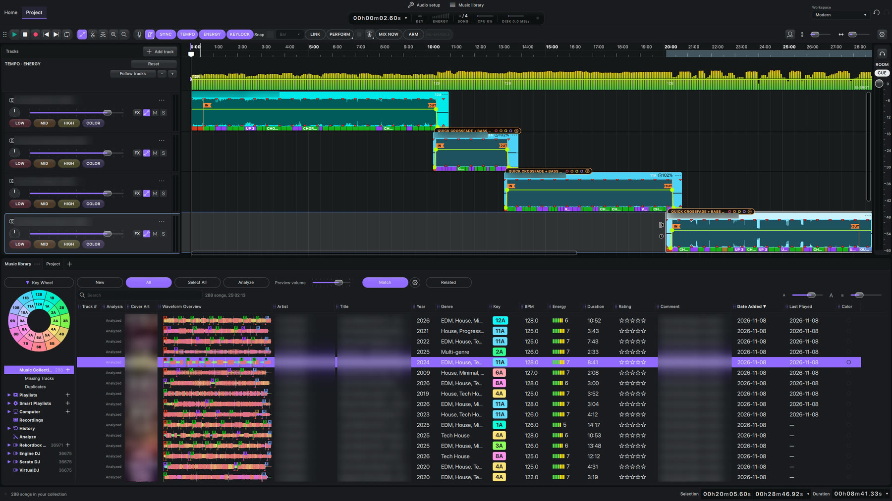
   <i>A mix of four songs: each song beatmatched, locked to the bar and linked IN → OUT.</i>

## What it does

**Fast analysis**
- A new song is ready in about **a second**: beat grid, phrases, key, energy and colour waveforms. On a Mac the beat grid runs on the graphics chip (Core ML) with the full, most accurate beat model.
- 288 songs in **4 min 42 s** on our test Mac (rekordbox 7 on the same songs: about 20 minutes). The same tempo as rekordbox on 98% of 200 test songs.
- A **status line** at the bottom shows what GlideMix is doing ("Analysing 7 of 20 · about 1 minute left", with a progress bar and Stop), explains any button you hover over, and tells you when a new version is out.

**New in 1.2.7: the MixMeister fade**
- **Volume Fade** is the new default transition: the playing song stays full up to its OUT, slides to half volume over 8 bars and cuts; the next song starts on its IN at half volume and rises to full.
- **Move an anchor, the mix follows:** drag an OUT or IN and every song after it moves along; the fade is redrawn from the new spot.
- **Right-click an IN or OUT flag** to switch between Volume Fade and the GlideMix transition (crossfade + bass swap), or turn it off.
- **See the silent part:** before the IN and after the cut the song is drawn faintly, so you see where you are while you move the IN.
- **Sounds like in the main library:** sort any list by how much it sounds like the song under the playhead.
- **Fixed:** Del / Backspace delete a song every time and take its empty lane with it; new lanes come in at the same height.

**New in 1.2.6: songs that sound alike**
- **Sounds like:** every song gets a small sound fingerprint when it's analysed (its tone, brightness, bass and groove, from the main part of the song, not the intro).
- **Related** compares the song **under the playhead** with all the others: among the songs whose key and BPM mix, the ones that sound most alike come first. The new **Sounds like** column says how alike: 85 % means more alike than 85 % of your library. Move the playhead to another song and the list follows.
- Songs analysed before get their fingerprint once in the background (a few hours for a big library); it waits while music plays.
- **LED meter** above the clock: a light show of what the audience hears, red lows to violet highs. Right-click to hide it.
- **Loops live under the ruler:** drag in the strip under the time numbers to loop, click the loop to turn it on or off. A click on the numbers just moves the playhead.
- **Audio setup** and **Music library** moved to the top right, beside the Workspace picker.

**New in 1.2.5: edit like in your DAW**
- **Ableton keys:** **Z** zooms to the selection and **X** goes back step by step, **⌘/Ctrl+E** splits, **⌘/Ctrl+L** loops the selection, **R** reverses, **⌘/Ctrl+1–4** narrow, widen, triplet and snap the grid. Some keys moved: Split was ⌘I, Record is now **F9**, Rename is **⌘/Ctrl+R**.
- **Tidier right-click menus** in Ableton's order: edit, zoom, split, loop, crop and reverse, **Cut / Paste / Delete time**, and a **Grid** section (1 bar to 1/32).
- **Thin automation lines** like Logic's, with the value beside each point: dB on volume, % on effects, BPM on the tempo line.
- **Icon toolbar:** icons only, grouped by job in capsules; hover a button to read what it does.
- **⌘/Ctrl+A** selects all songs while you're in the library, the whole timeline when you're there.
- **Fixed:** a crash when zoomed in close enough to see single samples.

**New in 1.2.4**
- Library preview fixes.

**New in 1.2.3: no more freezes, plus a few wishes**
- **No more long freezes** after a beat grid change, adding songs or at start, with a big library and many smart playlists: the smart playlist counts now run in the background.
- **IN and OUT from the keyboard:** select a song, put the playhead there and press **⌥/Alt+I** or **⌥/Alt+O**.
- **Rename a project** from its … menu on Home; the **Related tab's search box** narrows the related songs; on Windows, Task Manager shows the real version.

**New in 1.2.2: your plug-ins play along**
- **Tempo-synced plug-ins follow the beat:** loopers, tape stops, beat gates and beat FX now get the tempo (tempo lane glides too), the beat and the bar from GlideMix, VST3 and Audio Unit, on Mac and Windows.
- **AIR plug-ins no longer crash GlideMix** (AIR Compressor, AIR Enhancer and others that bring their own Qt, Serato Hex FX too; Mac).
- **No crash when quitting** with plug-ins like TimeStop or Hyperlift loaded.

**New in 1.2.1: your own toolbar**
- **Customize the toolbar like Safari:** right-click the toolbar (or click its gear) and drag buttons in, out and along it. Space and Flexible Space, a default set to go back to, and the choice of icon and text, icon only or text only, with new GlideMix icons.
- **Key column your way:** plain text, coloured text or coloured badges (Preferences > Music library).
- **Fixes:** tooltips show their text again, submenus open as you point at them, the transition dot at a clip's edge moves the line's start or end instead of adding dots, track headers line up with the timeline, no flashing in the library while songs are analysed.

**New in 1.2.0: a new look**
- **Modern and rounded:** every panel is its own rounded card, buttons are pills that turn purple when on, menus and lists are slightly see-through with a soft blur behind them.
- **A display at the top:** the clock, plus the key, energy and place in the mix (song 2 of 4) of the song under the playhead, processor and disk use, and a light that is green while playing.
- **Toolbar in groups:** play controls, editing tools, SYNC/TEMPO/ENERGY/KEYLOCK, LINK/PERFORM and MIX NOW/ARM each in their own capsule.
- **New knobs and faders:** flat knobs with a thin arc in the channel's colour, slim faders with see-through glass caps.
- **Library toolbar on top:** New, All, Select All, Analyze, Match and Related in one row with the Key Wheel; the search below them.
- **Light theme in GlideMix purple.**

**New in 1.1.33: Match, Related and Charcoal**
- **Match:** a button in the library. The Key cell turns green for songs that mix with the song under the playhead (BPM within a few percent, keys that fit), in every list, and it follows the playhead.
- **Related:** a tab with the songs that go with the song under the playhead, every column there, same key first, then the closest BPM.
- **One set of rules for both** (the gear next to Match): BPM ± %, half and double tempo, key, energy, year, date added, history, same artist, genre, composer, remixer, label or colour, rating stars, comment, any tag column, file format.
- **Charcoal:** a darker look. With Follow system theme on, a dark Mac or PC gets it by itself; the previous dark theme is now called Grey.
- **Sorting:** a third click on a column header goes back to the list's own order. New projects open on the Music library tab.

**New in 1.1.32: a faster library**
- **Your whole collection in the song list,** not 2000 songs at a time: scroll to the end, sort and search without waiting, even with 40,000 songs. The same for rekordbox XML, Lexicon and your other DJ apps.
- **Select All means all:** Analyze and the other actions reach every song; never-analysed songs go first and the Analyze count goes down as they finish.
- **Import from Rekordbox XML** shows a small window with its progress and what it found.

**New in 1.1.31: no more freezes with network drives**
- **Windows:** a mapped network drive that was offline or not ready made GlideMix freeze for up to 40 seconds, again and again. Drives are now checked in the background, and only local ones (internal, USB, SD card).

**New in 1.1.30: crash fix**
- **Mac:** hovering a track's volume fader no longer closes GlideMix; the fader's value tip shows again above the cap and follows it while you drag.

**New in 1.1.29: waveforms like the Beatgrid editor**
- **Waveforms:** the timeline and the library draw every song with the same colours and shape as the Beatgrid editor: pink and red kicks, blue hi-hats.
- **Your DJ apps on every drive:** Engine DJ, Serato and VirtualDJ libraries on an SD card or USB drive are read too.
- **Preferences > Library:** show or hide each DJ app, and add a folder if an app keeps its library somewhere else.
- **Stems:** a song split into stems has one transition pill; every change reaches the song and all its stems.

**New in 1.1.28: Ableton Link and your other DJ apps**
- **Ableton Link:** the LINK button shares your mix's tempo, beat and play/stop with Resolume, TouchDesigner and other Link apps.
- **Engine DJ, Traktor, Serato, VirtualDJ and djay** show in the library, and their beat grids and keys are used instead of analysing again. Mixed In Key's key and energy are read from the comment.
- **Low, Mid, High and Color** buttons in every track header: a quick bass cut anywhere in a song is one click away.
- **Library:** past 2,000 songs, Back after Show in Library, saved searches as smart playlists, columns for any file tag, Export as M3U8.
- **Automation:** type an exact value for a point, and move several points at once.

**New in 1.1.24: your mix wears your artwork**
- **Artwork**: choose a photo in the Metadata editor and it goes into your exported file, together with the title and artist tags.

**New in 1.1.22: big mixes stay usable**

  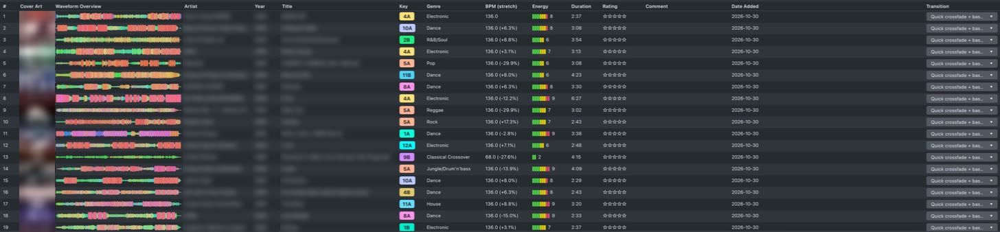

- **The Project tab looks like the library**: cover art, waveform, key, genre, energy, duration and rating for every song in your mix, with the transition pinned on the right.
- **Load a whole range**: Shift-select songs in the library, right-click, Load to > Project. They join the end of the mix in the same order, each one blended into the next.
- **Reset view** in front of the zoom sliders puts lanes back at their default height with the first songs readable. Lanes and headers stay together at 30 songs and more, and you keep your place when lanes change height.
- **What's new** after each update: GlideMix tells you what changed the first time it starts.

**Your mix as a playlist**

  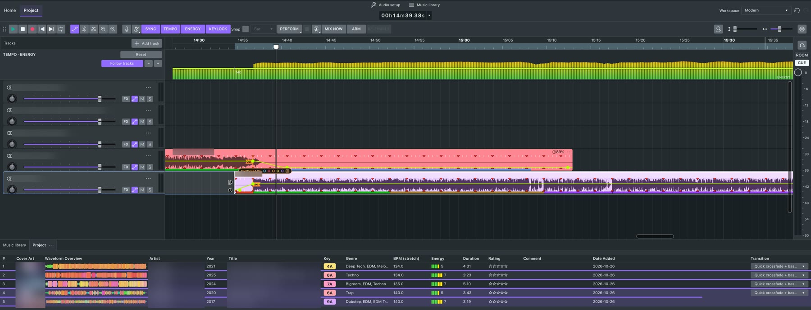

- The **Project tab**, next to Music library, lists your mix in order, with the transition into the next song on every row.
- **Drag a row to reorder**: every song snaps in, IN on the previous OUT, the lanes follow, and one Undo puts it all back.
- **A song added from the library always lands linked**, and deleting a song closes the gap. **Click a row** and the timeline zooms to that song.
- **Smooth blends by default**: the new song fades in and is at full volume on its IN, the old one leaves after its OUT, and the bass changes hands right there.

**Your music, analysed like a DJ app**
- **Tip for rekordbox and Lexicon users:** analyse your whole library there first (rekordbox: BPM/Grid, KEY and Phrase on), then open it in GlideMix. Those songs come with their beat grids, keys, cues and phrases and need no analysis at all; GlideMix only analyses songs those apps don't know.
- Tempo, beat grid, musical key (Camelot key wheel) and song phrases (intro, chorus, drop, outro), shown right on each song.
- Uses the analysis you already have: songs analysed in **rekordbox** or **Lexicon** take their beat grids and keys from there, in seconds.
- Reads your **rekordbox XML** and your **Lexicon** library, with their playlists.
- **Energy 1–10** for every song, like Mixed In Key and Lexicon (Lexicon songs keep Lexicon's own), shown as LED blocks in the library.
- Keys as **coloured badges** in the key wheel's colours, and five-star ratings like rekordbox.
- **Watch folders**: copy or download a song into your music folder and it appears in the library a few seconds later, already analysed.
- **Cue points** on the library waveforms, like rekordbox.
- **Find Duplicates** (best copy first) and a **Smart Playlist generator** (one per genre, key or energy level).
- **Ratings, colors and Edit Tags** like in rekordbox: stars, rekordbox's 8 track colors, and right-click → **Edit Tags…** for one song or many. Tags are saved into the music files, so rekordbox and Lexicon see them after re-reading the tags.
- **Smart Playlists**: playlists that fill themselves from rules (genre, BPM, key "mixes with", rating, color, date added…), from your collection, Lexicon or rekordbox, like rekordbox's Intelligent Playlists and Lexicon's Smartlists.
- **Export** any playlist to a folder (songs in order, a track list and an .m3u8), or your whole collection to a **rekordbox XML** for rekordbox and Lexicon. Songs without cue points get hot cues where their phrases start (Intro, Chorus, Outro…), ready for CDJs.
- **Key wheel**: click a key on the Camelot wheel and the library shows only the songs in that key; click more keys to add them. Perfect for harmonic mixing.

  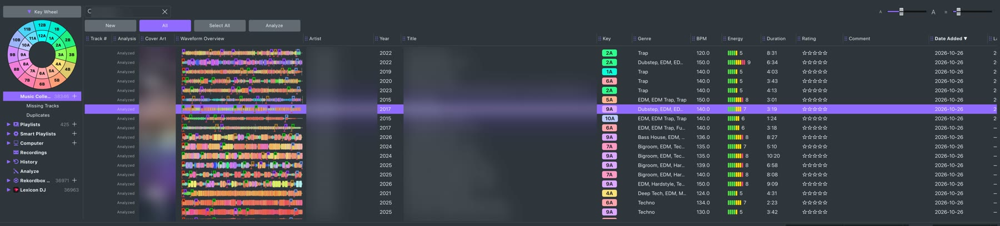
   <i>The library: colour waveforms with cue points, key badges, energy blocks and ratings.</i>

  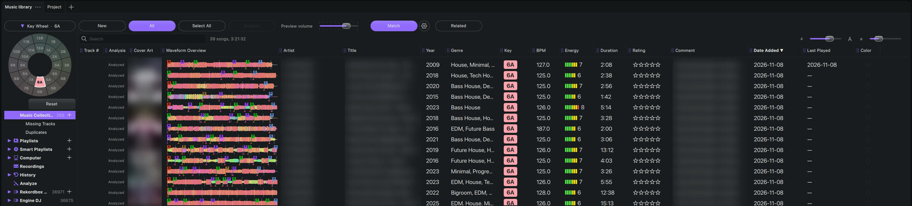
   <i>Click 6A on the key wheel: only songs in 6A are left.</i>

**Find the next song fast**
- **Search terms** in the search box: `bpm:128`, `~bpm:128` (near 128) and `key:8A`, in any key notation (8A, 1m, Am).
- **Search related Tracks:** right-click a song and search by its artist, album, title or key. The search shows on the key wheel or in the search box, and one click clears it.
- **Preview without loading:** hover the cover art and click play, click the waveform to jump.

  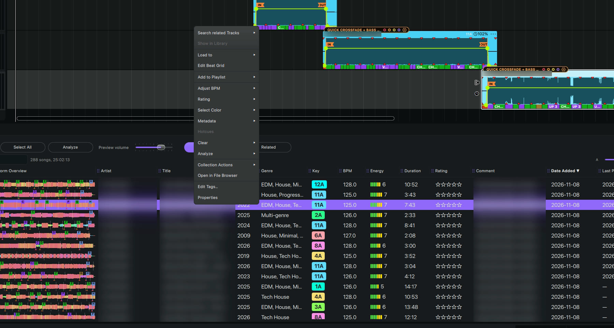

**Mixing on a timeline**
- Drag songs from the library onto the timeline, or double-click to add them at the end of the mix.
- **Sync**: every song stretched to the mix tempo and locked to the bar. **Keylock** keeps the pitch.
- **Songs that jump off their beat grid** (stitched demos, edits, mashups): right-click the song → **Split at grid jumps**, and it is cut where the beats move with the later part slid back onto the bar, so the metronome and your other songs stay on the kicks.
- **IN / OUT** markers snap the next song into the previous one's outro.
- A **tempo line** for tempo changes across the mix; songs follow it. Tempo changes glide in an **S-curve**, smooth at both ends like a hand on the pitch fader (or straight, your choice per point).
- **Energy of the mix** drawn like a row of level meters behind the tempo line: green when calm, yellow as it builds, red at the peak. See how your set builds and where it drops.
- **Mix Now** pulls the next song in at the next bar.
- **Loops and repeats like Logic and Ableton**: drag across the top of the ruler to loop a section, right-click a selection for **Loop** or **Split**, and press **Cmd+D** (Ctrl+D) to repeat the selection right after itself, in whole bars with Sync on.
- **Transitions** you build yourself: crossfade, fade, bass/mid/high swap, filter sweeps, risers, echo or reverb outs, each fade with its own shape (equal power, linear, S-curve, early, late).
- **Transition effects** added in the transition panel act inside the transition only, each with its own on/off, amount and remove. **Right-click a transition's pill** to switch it off (grey) and back on.

  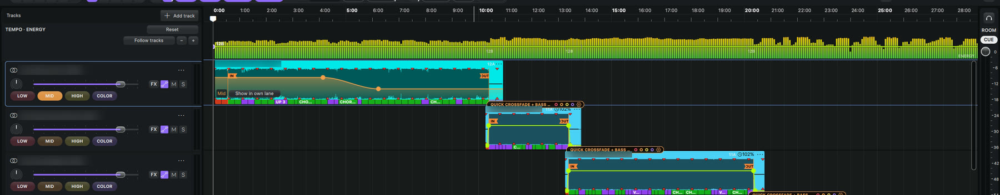
   <i>The energy of the whole mix, green to red, with the tempo line on top.</i>

**Colour waveforms**
- **HD colour waveforms** on the timeline and in the library: **bass red, mids green, highs blue**, each drawn as its own layer. A drop shows red and pink, a breakdown blue, vocals and leads green.
- Zoom in to single beats: the grid, the phrases and the cue points stay on the song.
- **DJ style** (RGB on black) or **Classic** in the track colour. New songs open in **single wave**: one waveform in half the height, so more of the mix fits on screen.
- **View → Track view** shows every song at once as Waveform, Spectrogram, Multi-view, Half-wave or Single wave (also in Preferences → Waveforms); right-click a song or its track name for **Color** and **Track visualization** of that track.

  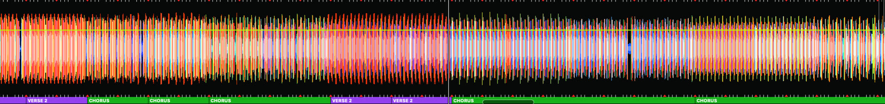
   <i>Close up: the chorus in red and blue, the breakdown, then the vocal part in green.</i>

**A DJ mixer for every transition**
- Open a transition as a **2-channel mixer laid out like a Pioneer DJM**: CH 1 is the song going out, CH 2 the song coming in.
- **HI / MID / LOW with KILL**, a **COLOR** filter knob and a **channel fader** per channel; a **crossfader** with **Smooth / Constant / Cut** curves.
- **BEAT FX**: Echo, Reverb, Roll, Brake, Tape stop, Riser and Sweep, with **LEVEL/DEPTH** and a big **ON/OFF**.
- Press **REC**, play, and ride the knobs: every move is written into the transition as automation.
- Pick it in **Preferences → Transitions → The transition pill opens: The DJ mixer**. The classic transition window stays.
- Or keep the **classic transition window**: its knobs and VOL fader change the sound while you turn them, record the move while the mix plays, and each move is one undo step.

  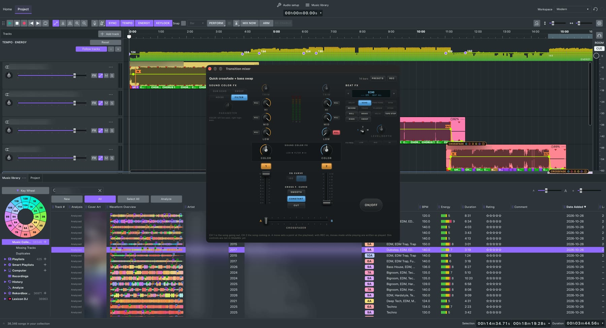
   <i>The transition as a DJ mixer: kill the bass of the song going out, set the crossfader, switch on an echo, and REC it into the mix.</i>

**Effects and automation, the Ableton way**
- Built-in DJ effects: filter, echo, reverb, risers, sweeps and more.
- **Automation for any knob of any plugin**, drawn right on the song: click to add a point, drag it; new ramps glide in an **S-curve** (right-click a point for straight), hold **Option** to bend a ramp into a curve. Each knob has its own colour, and all of a song's lines show at once.
- **Arm** and record: move a knob while the mix plays and GlideMix writes the move into the line. Let go, and the line plays on as it was.
- Optional **own lane** per parameter under the track, as in Ableton.

  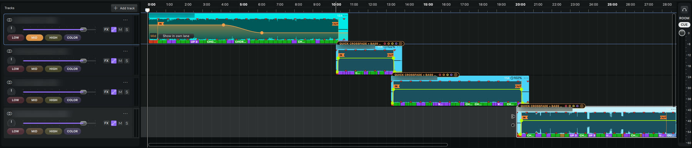
   <i>A volume line drawn as S-curves: the waveform follows it.</i>

**Your plugins: VST3 and Audio Unit**
- Use the plugins you already own: **VST3** on macOS and Windows, **Audio Unit** on macOS.
- Put them on a song, on a stem or on the whole mix, with as many in a row as you like.
- Open the plugin's own window, or tweak its knobs inside GlideMix. Every knob can be automated and recorded like the built-in effects.

  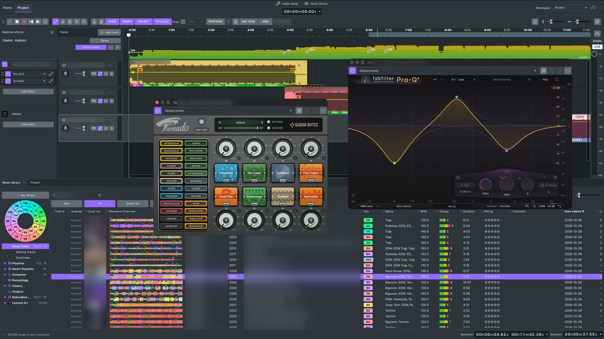
   <i>FabFilter Pro-Q 4 and Sugar Bytes Turnado open on a song, each knob ready to automate on the clip.</i>

**Stems**
- **Separate stems** splits a song into **drums, bass, vocals and other**, each on its own lane under the song, named and coloured by stem.
- Mute, fade, filter or automate each stem on its own: drop the vocals of one song over the beat of the next, or bring in the bass only on the drop.
- Runs on your own computer: nothing is uploaded. The stems engine (Demucs) downloads once, the first time you use it. Choose standard or high quality in Preferences.

  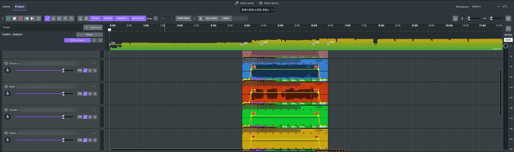
   <i>One song split into stems: drums, bass, vocals and other, each on its own lane.</i>

**Beat grid editor**
- When a beat grid is off, fix it like in rekordbox: the whole song's colour waveform, a zoomed beat view with bar numbers, and the song's phrases underneath.
- Move the grid beat by beat, set bar 1 (**1.1**), halve or double the tempo, **tap** it, or take rekordbox's grid (**RB**). **Lock** a grid once it's right.
- Edit phrases (intro, chorus, drop, outro): cut, rename, fill, delete.
- Play, cue, loop and a metronome click to check the grid by ear.

  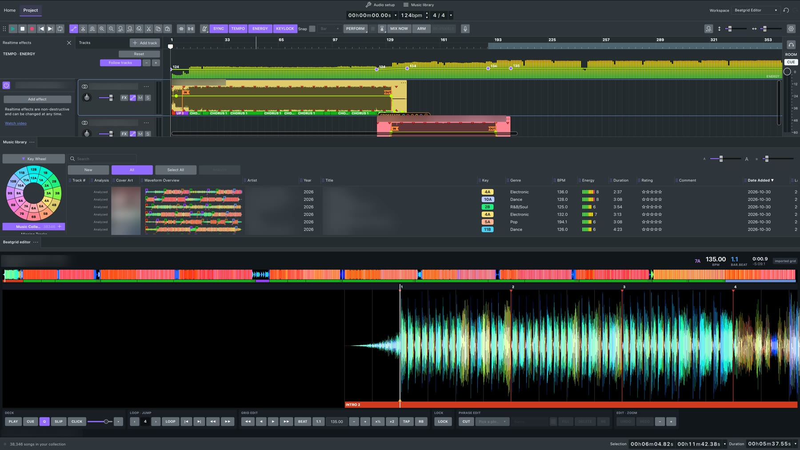
   <i>The beat grid editor: the whole song on top, the beats close up below, with grid, phrase and loop tools.</i>

**Play it, perform it, share it**
- **Two playheads, like a DJ mixer with cue**: **Perform** plays the mix to the audience (outputs 1–2, red playhead) while the white playhead previews any other part of the mix on your headphones (outputs 3–4). Check the next transition while the crowd hears the current one.
- **Broadcast live** to your radio: **Shoutcast** (v1 and v2) and **Icecast** servers, straight from GlideMix, with the song titles sent to your listeners.
- **Export** the finished mix (WAV, AIFF, MP3, FLAC…) exactly as it sounds, through a **true-peak limiter** (-1 dBTP), so it never clips, not even as an MP3.
- **Tracklist** with every export: a timestamped list for Mixcloud and show notes, plus a .cue sheet.
- **Loudness report** after every export: LUFS, true peak and peak, and what Spotify, YouTube and Apple Music will do with your mix.

  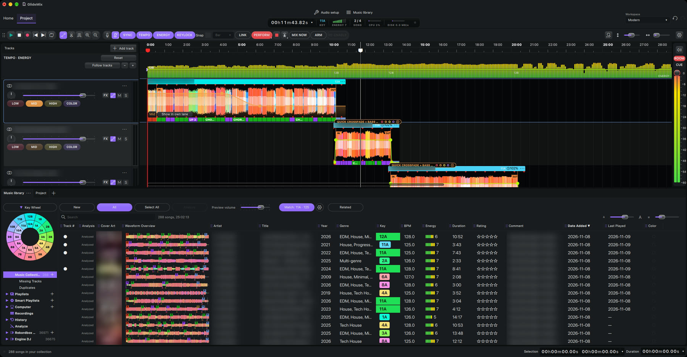
   <i>Perform: the red playhead plays to the room, the white one is your headphone cue.</i>

  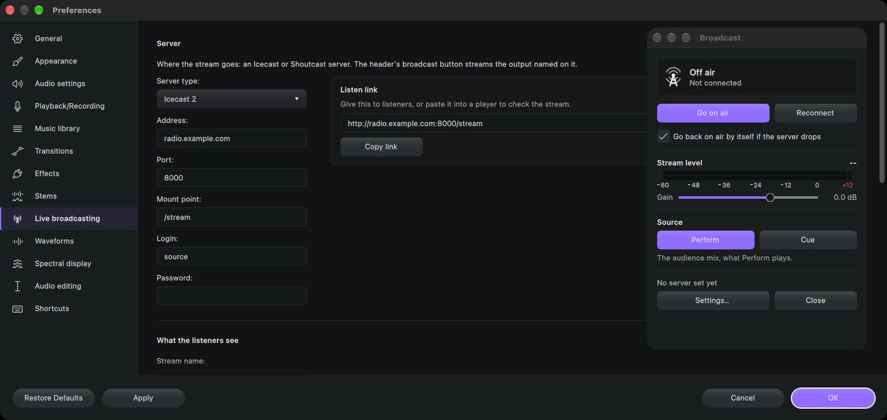
   <i>Broadcast live to Icecast or Shoutcast.</i>

## A look at something we're working on: Main FX

A new tab for shaping the whole mix: effects on the master, a Scene pad, your own plug-ins, and a mic for voice over.

It is in development and still a long way off. There is no date. It will come when it is polished, not before. It will be included for paid GlideMix users.

  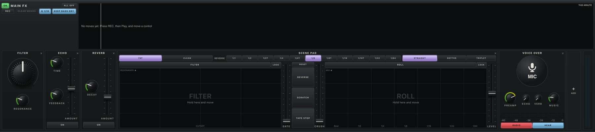
   <i>From a private test version, so everything you see may still change.</i>

## Download and install

Would you like the **ready-to-run program** or the **source code**?

### Ready-to-Run Program

Just download and run GlideMix on your Mac or PC, from **[Releases](../../releases/latest)**:

| | File |
|---|---|
| **macOS** (Apple Silicon, macOS 13 or later) | `GlideMix-Beta-v….dmg` |
| **Windows** 10 / 11 (64-bit) | `GlideMix-Beta-v…-x64-setup.exe` |

Every download starts as the **free demo**: everything works, but every 2 minutes a voice says "Glide Mix demo"
over the music, and exports are MP3 at 96 kbps, up to 20 minutes.
A licence removes the limits for good — **[GlideMix – €49](https://buy.polar.sh/polar_cl_4uiOdwpksKcRSApaB9BWrDJ0Scu1AFet9FgtC4ZQyQJ)** ~~€89~~: everything unlocked, stems included. One-time payment, 3 computers, all 1.x updates.

**Beta price: €49 instead of €89** while GlideMix is in Beta; the normal price of €89 starts when the Beta ends. After buying, open **Access purchase** in the order email to see your key, then enter it in GlideMix under **Help → Licence…**.

**macOS:** open the DMG and drag GlideMix to Applications. GlideMix is not yet signed by Apple,
so the first time: open it once, then go to **System Settings → Privacy & Security** and click **Open Anyway**.

**Windows:** run the setup. If SmartScreen warns, click **More info → Run anyway**.

### Source Code

Every release also has the complete source code (`GlideMix-…-source.tar.xz`, GNU GPL).
You'll need to build it yourself. That can be a challenging and complex process, especially on macOS and Windows.
We don't provide help for this process and can't support the end result. If you just want to use GlideMix, choose the ready-to-run program.

### Updates

GlideMix checks for new versions by itself and shows what's new.
You can also use **Help → Check for update**. On the Mac, updates install with one click.

## Community

The full **[Manual](https://glidemix.com/manual)** and answers to common questions (**[FAQ](https://glidemix.com/help)**) are on glidemix.com.
Questions, bug reports, ideas, or a mix you made with GlideMix? Join the **[GlideMix Discord](https://discord.gg/EvWwBAvfuE)** to chat, or post in **[r/GlideMix](https://www.reddit.com/r/GlideMix/)** on Reddit.

## Beta

GlideMix is in beta: it's tested and improved every week, and you may still find bugs.
Every release lists its changes on the [Releases](../../releases) page, and the whole story since the first build (13 September 2026) is in the **[development history](CHANGELOG.md)**. Found a bug? Tell us in `#bug-reports` on [Discord](https://discord.gg/EvWwBAvfuE).

GlideMix is built on [Audacity](https://www.audacityteam.org/) (GPL v3).
It works with **rekordbox** and **Lexicon** libraries (read-only). rekordbox is a trademark of AlphaTheta Corporation; Lexicon is a product of Lexicon DJ. GlideMix is not affiliated with or endorsed by them.
This repository holds the installers, the source code archives and the release notes.
