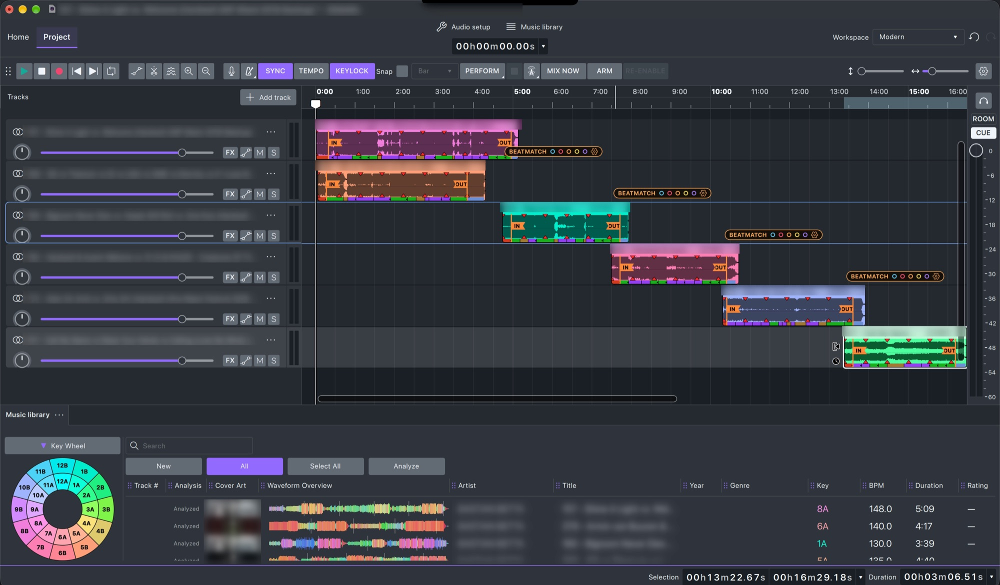
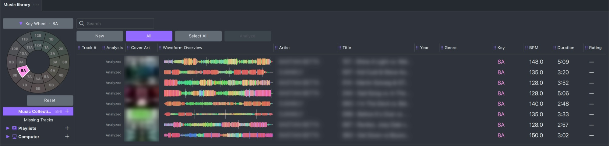
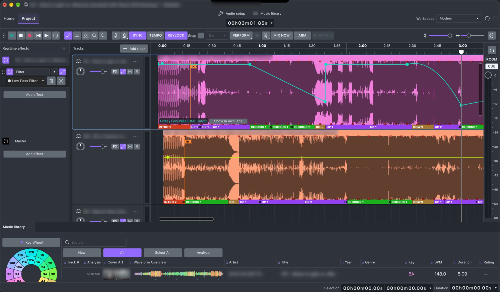
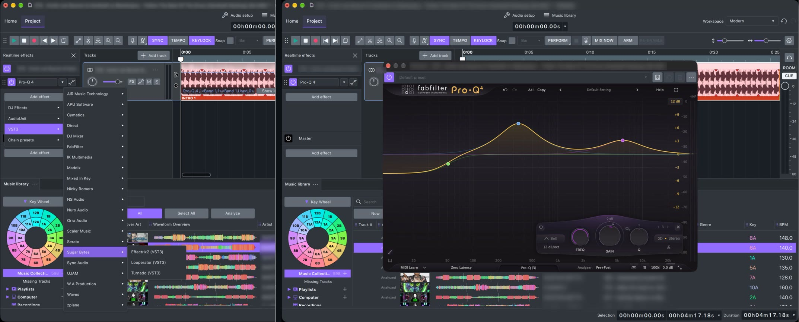
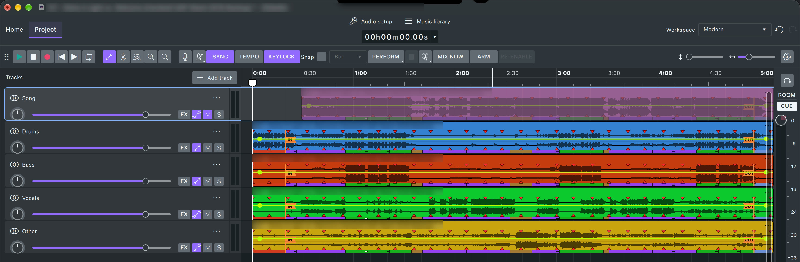
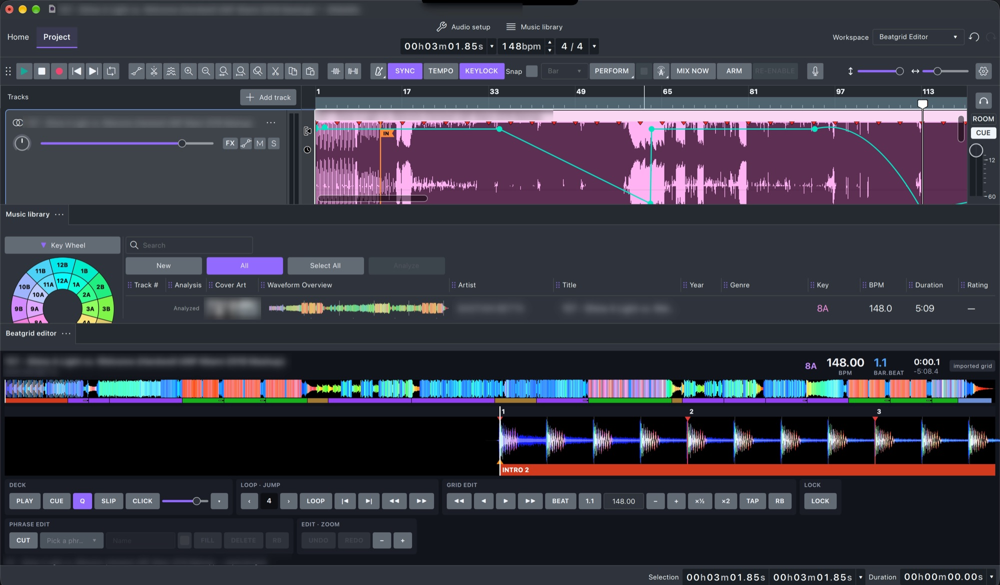
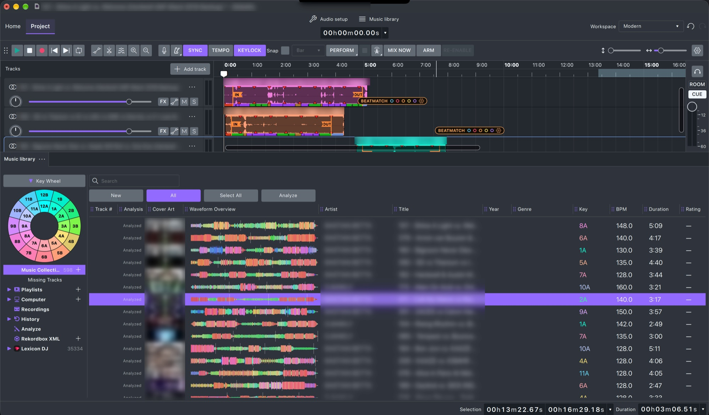

  

<h1 align="center">GlideMix</h1>

  <b>Build DJ mixes on a timeline. Every transition perfect, every beat in place.</b> 
  For DJs who prepare mixtapes, radio shows and sets, on macOS and Windows.

  <a href="../../releases/latest"><b>⬇ Download the latest version</b></a>
  &nbsp;·&nbsp; <a href="https://discord.gg/EvWwBAvfuE"><b>💬 Join us on Discord</b></a>
  &nbsp;·&nbsp; Beta · free demo · €49 one-time

---

## What is GlideMix?

GlideMix is a DJ mixing studio. Instead of mixing live on two decks, you lay your songs
out on a timeline, like in a DAW, and shape every transition at your own pace:
when the next song comes in, how long the blend lasts, which effects ride on it.
Then you play it back, perform it live, or export the finished mix.

It knows your music the way DJ software does: tempo, beat grid, key and the song's
structure (intro, chorus, drop, outro). Drop a song after another and GlideMix
beatmatches it, locks it to the bar and lines up its **IN** with the previous song's
**OUT**, so the mix is in time from the first drop.

  
   <i>A mix of six songs: each song beatmatched, locked to the bar and linked IN → OUT.</i>

## What it does

**Your music, analysed like a DJ app**
- Tempo, beat grid, musical key (Camelot key wheel) and song phrases (intro, chorus, drop, outro), shown right on each song.
- Uses the analysis you already have: songs analysed in **rekordbox** or **Lexicon** take their beat grids and keys from there, in seconds.
- Reads your **rekordbox XML** and your **Lexicon** library, with their playlists.
- **Ratings, colors and Edit Tags** like in rekordbox: stars, rekordbox's 8 track colors, and right-click → **Edit Tags…** for one song or many. Tags are saved into the music files, so rekordbox and Lexicon see them after re-reading the tags.
- **Key wheel**: click a key on the Camelot wheel and the library shows only the songs in that key; click more keys to add them. Perfect for harmonic mixing.

  
   <i>Click 8A on the key wheel: only songs in 8A are left.</i>

**Mixing on a timeline**
- Drag songs from the library onto the timeline, or double-click to add them at the end of the mix.
- **Sync**: every song stretched to the mix tempo and locked to the bar. **Keylock** keeps the pitch.
- **IN / OUT** markers snap the next song into the previous one's outro.
- A **tempo line** for tempo changes across the mix; songs follow it.
- **Mix Now** pulls the next song in at the next bar.

**Effects and automation, the Ableton way**
- Built-in DJ effects: filter, echo, reverb, risers, sweeps and more.
- **Automation for any knob of any plugin**, drawn right on the song: click to add a point, drag it, hold **Option** to bend a ramp into a curve. Each knob has its own colour, and all of a song's lines show at once.
- **Arm** and record: move a knob while the mix plays and GlideMix writes the move into the line.
- Optional **own lane** per parameter under the track, as in Ableton.

  
   <i>Automation: a low-pass filter sweep drawn on a song. A ramp down into the drop, snapped open, then a curve into the outro.</i>

**Your plugins: VST3 and Audio Unit**
- Use the plugins you already own: **VST3** on macOS and Windows, **Audio Unit** on macOS.
- Put them on a song, on a stem or on the whole mix, with as many in a row as you like.
- Open the plugin's own window, or tweak its knobs inside GlideMix. Every knob can be automated and recorded like the built-in effects.

  
   <i>Your plugins sorted by maker, under Audio Unit and VST3. Right: FabFilter Pro-Q 4 open on a song.</i>

**Stems**
- **Separate stems** splits a song into **drums, bass, vocals and other**, each on its own lane under the song, named and coloured by stem.
- Mute, fade, filter or automate each stem on its own: drop the vocals of one song over the beat of the next, or bring in the bass only on the drop.
- Runs on your own computer: nothing is uploaded. The stems engine (Demucs) downloads once, the first time you use it. Choose standard or high quality in Preferences.

  
   <i>One song split into stems: drums, bass, vocals and other, each on its own lane.</i>

**Beat grid editor**
- When a beat grid is off, fix it like in rekordbox: the whole song's colour waveform, a zoomed beat view with bar numbers, and the song's phrases underneath.
- Move the grid beat by beat, set bar 1 (**1.1**), halve or double the tempo, **tap** it, or take rekordbox's grid (**RB**). **Lock** a grid once it's right.
- Edit phrases (intro, chorus, drop, outro): cut, rename, fill, delete.
- Play, cue, loop and a metronome click to check the grid by ear.

  
   <i>The beat grid editor: the whole song on top, the beats close up below, with grid, phrase and loop tools.</i>

**Play it, perform it, share it**
- **Two playheads, like a DJ mixer with cue**: **Perform** plays the mix to the audience (outputs 1–2, red playhead) while the white playhead previews any other part of the mix on your headphones (outputs 3–4). Check the next transition while the crowd hears the current one.
- **Broadcast live** to your radio: **Shoutcast** (v1 and v2) and **Icecast** servers, straight from GlideMix, with the song titles sent to your listeners.
- **Export** the finished mix (WAV, AIFF, MP3, FLAC…) exactly as it sounds, with a limiter, so it never clips.

  
   <i>The library: key wheel, colour waveforms, key and tempo, with your rekordbox XML and Lexicon collections.</i>

## Download and install

Would you like the **ready-to-run program** or the **source code**?

### Ready-to-Run Program

Just download and run GlideMix on your Mac or PC, from **[Releases](../../releases/latest)**:

| | File |
|---|---|
| **macOS** (Apple Silicon, macOS 13 or later) | `GlideMix-Beta-v….dmg` |
| **Windows** 10 / 11 (64-bit) | `GlideMix-Beta-v…-x64-setup.exe` |

Every download starts as the **free demo**: everything works, but every 2 minutes the sound goes quiet for a few seconds,
exported mixes get a short noise in those gaps, and an export stops after 20 minutes.
A licence removes the limits for good — **[GlideMix – €49](https://buy.polar.sh/polar_cl_4uiOdwpksKcRSApaB9BWrDJ0Scu1AFet9FgtC4ZQyQJ)**: everything unlocked, stems included. One-time payment, 3 computers, all 1.x updates.

Early Beta price. After buying, open **Access purchase** in the order email to see your key, then enter it in GlideMix under **Help → Licence…**.

**macOS:** open the DMG and drag GlideMix to Applications. GlideMix is not yet signed by Apple,
so the first time: open it once, then go to **System Settings → Privacy & Security** and click **Open Anyway**.

**Windows:** run the setup. If SmartScreen warns, click **More info → Run anyway**.

### Source Code

Every release also has the complete source code (`GlideMix-…-source.tar.xz`, GNU GPL).
You'll need to build it yourself. That can be a challenging and complex process, especially on macOS and Windows.
We don't provide help for this process and can't support the end result. If you just want to use GlideMix, choose the ready-to-run program.

### Updates

GlideMix checks for new versions by itself and shows what's new.
You can also use **Help → Check for update**. On the Mac, updates install with one click.

## Community

Questions, bug reports, ideas, or a mix you made with GlideMix? Join the **[GlideMix Discord](https://discord.gg/EvWwBAvfuE)**.

## Beta

GlideMix is in beta: it's tested and improved every week, and you may still find bugs.
Every release lists its changes on the [Releases](../../releases) page, and the whole story since the first build (13 September 2026) is in the **[development history](CHANGELOG.md)**. Found a bug? Tell us in `#bug-reports` on [Discord](https://discord.gg/EvWwBAvfuE).

GlideMix is built on [Audacity](https://www.audacityteam.org/) (GPL v3).
It works with **rekordbox** and **Lexicon** libraries (read-only). rekordbox is a trademark of AlphaTheta Corporation; Lexicon is a product of Lexicon DJ. GlideMix is not affiliated with or endorsed by them.
This repository holds the installers, the source code archives and the release notes.
